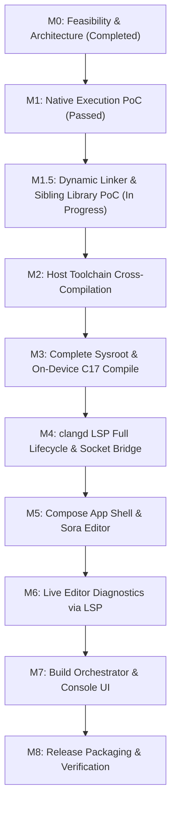

# Tanmatsu (端末)

> **Standalone Android C IDE without Termux dependency.**

Tanmatsu is an Android-native integrated development environment designed to provide a complete, self-contained C programming environment on Android devices. Unlike conventional workflows that rely on Termux, PRoot, or external emulation layers, Tanmatsu bundles and executes upstream Clang, LLD, and clangd directly within Android's sandboxed environment.

---

## 1. Key Architectural Decisions

| Component | Technology | Rationale |
|---|---|---|
| **Platform** | Android (`minSdkVersion 26/28`, `targetSdkVersion 28`) | Android 8.0+ minimum; `targetSdkVersion 28` enables user executable execution in Phase 1 |
| **App Architecture** | Kotlin 2.0+ & Jetpack Compose | Modern declarative UI, coroutines for asynchronous process I/O and LSP streaming |
| **Design System** | Material 3 Expressive | Modern Android styling, dynamic color theming, adaptive ergonomics |
| **Target ABI** | ARM64 (`arm64-v8a` / `aarch64`) | Dominant modern Android architecture |
| **Compiler & Linker** | Clang / LLVM (v18.x+) & LLD | Native ARM64 code generation, Android Bionic target triple |
| **Language Intelligence**| clangd Language Server | Upstream LSP daemon providing diagnostics, completions, and cross-references |
| **C Standard & Runtime** | ISO C17 & Android Bionic | Native system C library on Android; zero additional libc overhead |
| **Code Editor** | Sora Editor (`0.24.x`) | Native Android code editor with Compose interop and `LocalSocket` LSP support |

---

## 2. Repository Directory Overview

```text
.
├── AGENTS.md                  # Persistent engineering guide, verified facts, and milestones ledger
├── README.md                  # Project overview, architecture, and reproduction instructions
├── .gitignore                 # Exclusions for Android, Gradle, NDK, CMake, and LLVM builds
├── docs/                      # Technical documentation and experiment specifications
│   ├── ARCHITECTURE.md        # Comprehensive system architecture proposal (v2.1)
│   ├── DEVELOPMENT_ROADMAP.md # Sequential milestones, deliverables, and acceptance gates
│   ├── TECHNICAL_FEASIBILITY.md # Empirical feasibility findings, W^X analysis, licensing
│   └── TOOLCHAIN_EXPERIMENTS.md # Step-by-step reproducible toolchain and PoC experiment guide
└── experiments/               # Validated proof-of-concept projects
    ├── poc_native_exec/       # M1: Standalone ARM64 PIE execution Android harness
    │   ├── app/               # Minimal Android application packaging native executable
    │   ├── poc_test.c         # C source for standalone PIE test binary
    │   └── README.md          # Step-by-step manual build and verification instructions
    └── poc_dynamic_linker/    # M1.5: Dynamic linker, sibling .so, and $ORIGIN resolution
        ├── build_test.sh      # Automated host build, NDK validation, and ELF tag inspector
        ├── dep.c              # Custom sibling shared library source
        ├── dyn_test.cpp       # C++ executable exercising sibling .so and libc++_shared
        └── README.md          # Step-by-step instructions and acceptance gates ledger
```

---

## 3. Current Development Status & Roadmap

Tanmatsu follows an evidence-based roadmap where native prerequisites are empirically validated before constructing higher-level IDE UI abstractions:



### Milestone Progress Ledger

| Milestone | Title | Status | Evidence / Notes |
|---|---|---|---|
| **M0** | Feasibility & Architecture Baseline | **Completed** | Full documentation suite delivered and approved. |
| **M1** | Standalone Native Execution PoC | **Completed / Passed** | Verified on Samsung SM-A065F (Android 16, API 36, `arm64-v8a`). `libtanmatsu_test_exec.so` extracted to `nativeLibraryDir`, executed via `ProcessBuilder`, exit code 0, 0 AVC denials. |
| **M1.5** | Dynamic Linker & Sibling Library PoC | **In Progress** | Gate 1 (Host ELF verification) **Passed**. Gates 2–5 pending physical device verification. |
| **M2** | Host Minimal LLVM Cross-Compilation | *Pending* | Host cross-compilation of Clang, LLD, and clangd for Android ARM64. |
| **M3** | Sysroot & On-Device C17 Compile | *Pending* | Compiling `hello.c` to `a.out` using on-device Clang and Bionic sysroot. |
| **M4** | clangd LSP Full Lifecycle & Socket Bridge | *Pending* | Validating JSON-RPC over `LocalSocket` bridge with stdio redirection. |
| **M5** | Compose App Shell & Sora Editor | *Pending* | Editor integration with syntax highlighting and Compose UI. |
| **M6** | Live Diagnostics via LSP | *Pending* | Real-time compiler error annotations and squiggly underlines. |
| **M7** | Build Orchestration & Console UI | *Pending* | In-app build pipeline and interactive standard I/O console. |
| **M8** | Packaging, Hardening & Verification | *Pending* | Release packaging and multi-device compatibility testing. |

---

## 4. Reproducing the Experiments

### Prerequisites
- Linux x86_64 host workstation
- Android NDK r27 LTS (or r26c)
- OpenJDK 17 or 21
- Android device with USB Debugging enabled (ARM64)

### Reproducing Milestone 1.5 (Dynamic Linker PoC)

1. **Build and Verify Host ELF Tags (Gate 1):**
   ```bash
   cd experiments/poc_dynamic_linker
   export ANDROID_NDK_ROOT="$HOME/Android/Sdk/ndk/27.0.12077973"
   ./build_test.sh
   ```
   *`build_test.sh` automatically compiles `libtanmatsu_dep.so`, compiles `libtanmatsu_dyn_test.so` with `DT_RUNPATH=$ORIGIN`, validates ELF headers via `llvm-readelf`, and stages the `.so` artifacts into `experiments/poc_native_exec/app/src/main/jniLibs/arm64-v8a/`.*

2. **Assemble and Install Test APK:**
   ```bash
   cd ../poc_native_exec
   ./gradlew assembleDebug
   adb install -r app/build/outputs/apk/debug/app-debug.apk
   ```

3. **Execute and Verify on Device (Gates 2–5):**
   ```bash
   # Launch Activity
   adb shell am start -n org.tanmatsu.poc/.MainActivity

   # Verify application logcat (Gates 2–4)
   adb logcat -s TanmatsuPoC -d

   # Audit SELinux AVC denials separately (Gate 5)
   adb logcat -d | grep -E 'avc:.*(org\.tanmatsu\.poc|libtanmatsu)'
   ```

---

## 5. Licensing & Attribution

A formal open-source license decision for the top-level Tanmatsu application is currently pending and under evaluation.

Component licenses and redistribution conditions are documented in detail in [`docs/TECHNICAL_FEASIBILITY.md`](file:///home/isaac/Development/AndroidApps/Tanmatsu/docs/TECHNICAL_FEASIBILITY.md) and [`AGENTS.md`](file:///home/isaac/Development/AndroidApps/Tanmatsu/AGENTS.md):
- **LLVM / Clang / LLD / clangd:** Apache-2.0 with LLVM Exception
- **Android Bionic Sysroot & CRT:** BSD-2-Clause and Apache-2.0
- **Sora Editor:** LGPL-2.1
- **Android NDK Prebuilts:** Subject to Android SDK License Agreement
