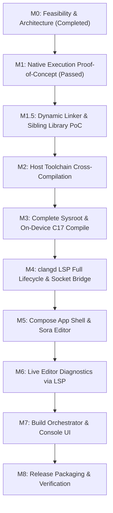

# Development Roadmap: Project Tanmatsu

**Document Version:** 2.1 (Revised Technical Baseline)  
**Status:** Approved Baseline  
**Date:** November 2026  

---

## 1. Roadmap Strategy & Operating Principles

Tanmatsu's development roadmap is structured into sequential milestones. Each milestone focuses on proving a critical technical capability before layering higher-level abstractions.

### Core Rules of Progression
1. **Verification Precedes Implementation:** No higher-level application layer will be constructed until its underlying native prerequisites are demonstrated on actual Android hardware or emulator.
2. **Minimal Proof-of-Concept First:** Before investing developer time and host resources into LLVM compilation, the APK-native-library execution mechanism must be empirically proven using the minimal 15 KB C executable in `experiments/poc_native_exec/`.
3. **Deterministic Token Conservation:** Lengthy, resource-intensive operations (LLVM cross-compilation, sysroot extraction, Gradle packaging) are prepared as manual developer execution scripts. Milestones specify exact acceptance commands.
4. **Evidence-Based Sign-off:** A milestone cannot be marked completed in `AGENTS.md` without concrete output logs, file hashes, and empirical verification data.

---

## 2. Milestone Overview

---

## 3. Milestone Details

### Milestone 0: Research Foundations & Technical Feasibility
- **Status:** **Completed**
- **Objective:** Establish the persistent project guide (`AGENTS.md`), rigorously analyze the Termux execution architecture (`targetSdkVersion = 28`, `termux-exec`, `system_linker_exec`, `APKLF`), analyze Android 10+ W^X constraints, determine LLVM cross-compilation viability, and define the core system architecture.
- **Deliverables:**
  - `AGENTS.md`
  - `docs/TECHNICAL_FEASIBILITY.md`
  - `docs/ARCHITECTURE.md`
  - `docs/DEVELOPMENT_ROADMAP.md`
  - `docs/TOOLCHAIN_EXPERIMENTS.md`
- **Acceptance Criteria:**
  - Clear documentation of the W^X restriction (`app_data_file` vs `apk_data_file`).
  - Separation of LLVM build host, execution host, target backend (`AArch64`), and user program target.
  - Identification of Sora Editor `LocalSocket` transport and socket-to-stdio bridge requirement.
  - Elimination of unsupported numerical estimates in favor of empirical hypotheses.

---

### Milestone 1: Native Execution Proof-of-Concept (PoC)
- **Status:** **Completed / Passed**
- **Objective:** Empirically verify that native executables packaged as `lib*.so` inside an APK execute successfully on Android hardware without SELinux denials, using a minimal test binary before building LLVM.
- **Verified Test Environment:**
  - **Device:** Samsung SM-A065F (Samsung Galaxy A06 4G)
  - **Android Version:** Android 16 (API Level 36)
  - **ABI:** `arm64-v8a`
  - **Workstation Build Environment:** Arch Linux, Gradle 8.10.2, OpenJDK 17.0.20
  - **Binary:** `libtanmatsu_test_exec.so` (4,600 bytes, ELF64, AArch64, DYN, PT_INTERP to `/system/bin/linker64`, entry point `0x16E8`)
- **Observed Results:**
  - Extracted to `nativeLibraryDir` with executable permissions (`canExecute() == true`).
  - `ProcessBuilder` executed binary without `IOException` or `EACCES`.
  - Process exited with code `0` (duration: 115ms).
  - Stdout received: `POC_SUCCESS: Native ARM64 PIE executed via ProcessBuilder PID=17652`.
  - Zero AVC denials in logcat matching `org.tanmatsu.poc` or `libtanmatsu_test_exec`.
- **Scope Boundaries Confirmed:** Proves standalone PIE executable launch from `nativeLibraryDir` under Android 16. Does *not* yet prove multi-library `$ORIGIN` resolution, LLVM execution, on-device compilation, or user program execution.

---

### Milestone 1.5: Dynamic Linker & Shared Library Resolution PoC
- **Status:** **Pending (Next Immediate Milestone)**
- **Objective:** Empirically verify that a native executable in `nativeLibraryDir` can dynamically resolve and execute functions from a **sibling custom shared library** and NDK **`libc++_shared.so`** using `DT_RUNPATH` with `$ORIGIN`, without requiring `LD_LIBRARY_PATH` or root privileges.
- **Why this is required before M2:** Clang and clangd are multi-library executables that link against `libLLVM.so`, `libclang-cpp.so`, and `libc++_shared.so`. Validating multi-library dynamic linking in `nativeLibraryDir` with a tiny (10 KB) test binary prevents encountering dynamic linker resolution failures after completing lengthy LLVM builds.
- **Scope:**
  - Create a custom shared library (`libtanmatsu_dep.so`) exporting a function `int get_tanmatsu_token(void)`.
  - Create a C++ PIE executable (`libtanmatsu_dyn_test.so`) linking against `libtanmatsu_dep.so` and `libc++_shared.so` with `-Wl,-rpath,'$ORIGIN'`, using `std::string` and calling the exported function.
  - Package all three `.so` files into `app/src/main/jniLibs/arm64-v8a/`.
  - Launch `libtanmatsu_dyn_test.so` via `ProcessBuilder` and verify that the dynamic linker resolves all sibling dependencies smoothly.
- **Deliverables:**
  - Test project in `experiments/poc_dynamic_linker/`.
  - Verified execution logs on physical Android hardware.
- **Acceptance Criteria (5 Distinct Gates):**
  - **Gate 1 (ELF Dependencies Verified):** `readelf -d libtanmatsu_dyn_test.so` shows `DT_NEEDED` listing `libtanmatsu_dep.so` and `libc++_shared.so`, and `DT_RUNPATH` contains `$ORIGIN`.
  - **Gate 2 (Package Extraction Verified):** All three `.so` files extracted into `nativeLibraryDir`.
  - **Gate 3 (Process Launch Verified):** Spawns without linker error `cannot locate symbol` or `library not found`.
  - **Gate 4 (Execution & Output Verified):** Returns expected output confirming function call across shared library boundary and C++ STL execution, exit code 0.
  - **Gate 5 (SELinux Denials Investigated):** Zero relevant AVC denials for `libtanmatsu_dyn_test.so`.

---

### Milestone 2: Host Cross-Compilation of Minimal LLVM Toolchain
- **Status:** Pending
- **Objective:** Cross-compile Clang, LLD, and clangd for Android ARM64 (`aarch64-linux-android`) on a Linux x86_64 workstation using the Android NDK.
- **Scope:**
  - Stage 1: Build host TableGen tools (`llvm-tblgen`, `clang-tblgen`).
  - Stage 2: Cross-compile minimal LLVM target with `AArch64` backend only (`-DLLVM_TARGETS_TO_BUILD="AArch64"`).
  - Install to dedicated prefix: `-DCMAKE_INSTALL_PREFIX=$HOME/tanmatsu-build/install-android-arm64`.
  - Reuse prebuilt NDK compiler-rt builtins archive.
  - Produce: `libtanmatsu_clang.so`, `libtanmatsu_clangd.so`, `libtanmatsu_lld.so`, `libLLVM.so`, `libclang-cpp.so`.
  - Strip unneeded symbols using `llvm-strip`.
  - Perform ELF dynamic header inspection (`llvm-readelf -d`) to verify `DT_NEEDED`, `DT_RUNPATH`, and `$ORIGIN`.
- **Manual Build Requirements:**
  - Execute CMake configure and Ninja build commands on the host machine as specified in `docs/TOOLCHAIN_EXPERIMENTS.md`.
- **Deliverables:**
  - Prebuilt ARM64 native binaries in `dist/arm64-v8a/`.
  - ELF inspection log `dist/elf_inspection.log`.
- **Acceptance Criteria:**
  - `file libtanmatsu_clang.so` reports `ELF 64-bit LSB shared object, ARM aarch64, version 1 (SYSV)`.
  - `readelf -d` confirms `DT_RUNPATH` contains `$ORIGIN`.
  - Binaries stripped and empirical file sizes recorded.

---

### Milestone 3: Complete Sysroot & On-Device C17 Compilation
- **Status:** Pending
- **Objective:** Demonstrate end-to-end on-device C compilation producing an executable ARM64 ELF binary that runs on Android, using the complete canonical NDK sysroot.
- **Scope:**
  - Use complete NDK sysroot directly (`$ANDROID_NDK_ROOT/toolchains/llvm/prebuilt/linux-x86_64/sysroot`).
  - Package Clang resource directory containing internal headers and prebuilt `libclang_rt.builtins-aarch64-android.a`.
  - Push to test device via ADB.
  - Invoke `libtanmatsu_clang.so` with `--target=aarch64-linux-android29 --sysroot=... -resource-dir=... --ld-path=... -fuse-ld=lld` on `hello.c`.
  - Enforce target API $\le$ physical device OS API.
  - Spawn the generated `hello` executable and capture output.
- **Deliverables:**
  - Device compilation test runner and verification output.
- **Acceptance Criteria:**
  - Clang compiles `hello.c` without missing header errors.
  - LLD successfully links `hello` with CRT startup objects and Bionic dynamic stubs.
  - Executing `hello` returns exit code 0 and prints output.

---

### Milestone 4: On-Device clangd Full Lifecycle & Socket Bridge Verification
- **Status:** Pending
- **Objective:** Verify that `libtanmatsu_clangd.so` executes on Android and completes the full 4-stage LSP lifecycle over a local socket bridge.
- **Scope:**
  - Spawn `libtanmatsu_clangd.so` with flags `--background-index=false -j=2`.
  - Implement a Kotlin `LocalServerSocket` (or TCP `ServerSocket`) bridge forwarding between the socket and clangd's stdio streams.
  - Direct clangd diagnostic logs to `stderr` and keep `stdout` reserved for framed JSON-RPC messages.
  - Execute complete lifecycle test:
    1. Send `initialize` request with byte-accurate `Content-Length`. Verify capabilities response.
    2. Send `initialized` notification.
    3. Send `shutdown` request. Verify `null` result.
    4. Send `exit` notification. Verify process exits with code 0.
  - Measure Resident Set Size (RSS) memory consumption via `/proc/<pid>/statm`.
- **Deliverables:**
  - `ClangdSocketBridgeTest.kt` in `experiments/lsp_harness/`.
  - Complete JSON-RPC communication trace log and empirical memory usage report.
- **Acceptance Criteria:**
  - Successful 4-stage LSP lifecycle handshake over local socket.
  - Clean process termination without orphan processes.
  - Empirical memory footprint documented.

---

### Milestone 5: Core Application Skeleton & Sora Editor Integration
- **Status:** Pending
- **Objective:** Construct the foundational Android IDE user interface using Jetpack Compose and embed the Sora Editor widget.
- **Scope:**
  - Setup package structure (`app`, `core`, `lang`, `infra`).
  - Implement Material 3 Expressive theme (colors, typography, adaptive layouts).
  - Wrap `CodeEditor` inside Compose `AndroidView`.
  - Integrate TextMate / Tree-sitter C grammar highlighting.
  - Implement line numbers, symbol input accessory bar, and buffer editing.
- **Deliverables:**
  - `SoraEditorWrapper.kt` and `EditorViewModel.kt`.
  - Working APK displaying interactive code editor.
- **Acceptance Criteria:**
  - Editor loads and displays C code with smooth touch scrolling and responsive text input.
  - C keywords, string literals, and preprocessor directives are highlighted accurately.

---

### Milestone 6: Editor-LSP Integration & Live Diagnostics
- **Status:** Pending
- **Objective:** Connect Sora Editor's `editor-lsp` extension to `ClangdSocketBridge` to provide live diagnostics squiggles, hover tips, and code completion.
- **Scope:**
  - Configure `editor-lsp` with `languageServerDefinition { connection { localSocket(address) } }`.
  - Route document change events to the language server.
  - Verify error squiggles (red wavy lines) and warning squiggles (yellow wavy lines).
  - Implement completion popup and hover inspection dialog.
- **Deliverables:**
  - `LspEditorBridge.kt` bridging `editor-lsp` to Tanmatsu workspace.
- **Acceptance Criteria:**
  - Introducing a syntax error produces a red wavy underline beneath the token in the editor.
  - Tapping the error shows the compiler explanation.
  - Resolving the error clears the underline automatically.

---

### Milestone 7: Build Orchestration & Execution Console UI
- **Status:** Pending
- **Objective:** Implement the one-click build and run workflow with an integrated terminal console.
- **Scope:**
  - Implement `BuildOrchestrator` state machine in Kotlin.
  - Create expandable Console Panel in Jetpack Compose.
  - Stream build progress (Compiling -> Linking -> Running).
  - Provide interactive standard input and real-time standard output display for running user programs.
  - Implement "Stop" execution action and timeout guard.
- **Deliverables:**
  - `ConsoleView.kt` and `BuildOrchestratorImpl.kt`.
- **Acceptance Criteria:**
  - Tapping "Run" compiles the current project and runs the program.
  - Console displays stdout in real-time.
  - Interactive input (`scanf`) functions correctly via console input field.

---

### Milestone 8: Distribution Packaging & Verification
- **Status:** Pending
- **Objective:** Package Tanmatsu into a standalone release APK, verify licensing notices, and validate across target devices.
- **Scope:**
  - Integrate all native binaries and sysroots into the production APK.
  - Generate complete `THIRD_PARTY_NOTICES`.
  - Validate on physical ARM64 Android devices across multiple Android versions.
  - Measure cold start time and storage footprint.
- **Deliverables:**
  - Standalone release APK.
  - Multi-device verification test report.
- **Acceptance Criteria:**
  - Zero external dependencies or setup scripts required by the user.
  - Clean installation, project creation, compilation, and execution verified.
